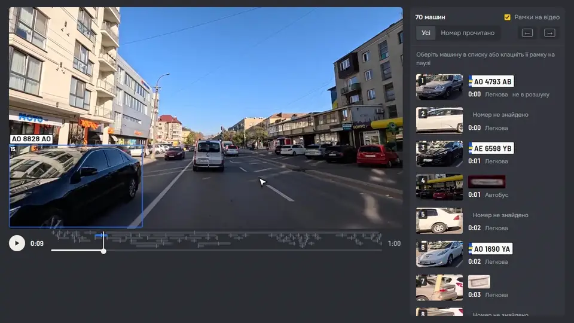
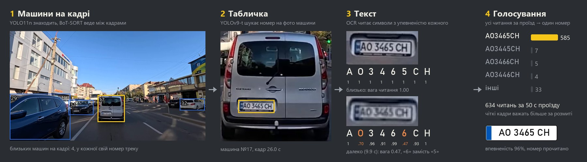

# Машини й номери на відео

Програма знаходить машини на відео, читає їхні номери й показує результат у браузерному плеєрі.

**[▶ Відкрити демо](https://nihlt.github.io/wanted-vehicle-video-detector/demo/)** (працює в браузері, нічого ставити не треба)


## Що вміє

- Обробляє будь-яке відео, яке відкриває ffmpeg (mp4, webm, mkv…): цілком або вибраний шматок.
- Обводить машини рамками, що рухаються разом з ними, і підписує над кожною її номер.
- Визначає один номер на всю машину за весь проїзд, тому підпис не скаче з кадру на кадр. Сумнівні номери позначає знаком «?».
- Збирає всі машини в список. Клік по машині ставить відео на кадр, де її номер видно найкраще, і показує збільшену вирізку номера.
- Читає українські номери, а також іменні (`KEL 106`) та іноземні (чеський `2TX 2967`).
- За бажанням перевіряє прочитані номери в базі розшуку МВС.



## Як це працює



1. **Машини на кадрі.** Береться кожен другий кадр (~30 за секунду). Детектор [YOLO11n](https://docs.ultralytics.com/models/yolo11/) від Ultralytics, навчений на датасеті COCO, знаходить на ньому легкові, вантажівки, автобуси й мотоцикли. Він працює на PyTorch, на відеокарті NVIDIA, якщо вона є.
2. **Та сама машина між кадрами.** Трекер [BoT-SORT](https://github.com/NirAharon/BoT-SORT) прогнозує, куди зсунеться кожна рамка (фільтр Калмана), і зіставляє прогноз з новими рамками від YOLO. Відео знято з автобуса, що їде, тому трекер ще й компенсує рух самої камери за оптичним потоком. Так кожна машина отримує свій номер від появи до зникнення.
3. **Номерний знак.** На кожній близькій машині (рамка від ~160×160 px) детектор YOLOv9-t з [open-image-models](https://github.com/ankandrew/open-image-models) шукає табличку. Вирізку таблички читає OCR-модель [fast-plate-ocr](https://github.com/ankandrew/fast-plate-ocr): вона повертає текст і впевненість для кожного символу. Обидві моделі у форматі ONNX і запускаються через onnxruntime.
4. **Один номер на машину.** За проїзд номер читається десятки чи сотні разів, і на розмитих кадрах OCR помиляється. Тому кожне читання голосує з вагою, що дорівнює впевненості його найслабшого символу, і перемагає текст з найбільшою сумою. Фургон з картинки вище прочитано 634 рази, з них 585 як `AO3465CH`.
5. **Плеєр.** Результат зберігається в `data.js` (рамки на кожному обробленому кадрі й картки машин) разом з вирізками машин і номерів. Плеєр — статична сторінка на HTML і JavaScript без фреймворків: малює рамки в SVG поверх `<video>` і ставить їх між порахованими кадрами пропорційно часу, тому вони рухаються плавно.

За бажанням (`--wanted`) прочитані номери перевіряються в базі розшуку МВС через сайт [cardetect.in.ua](https://cardetect.in.ua/wanted-check).

## Запуск

Потрібні Python (перевірено на 3.13) і [ffmpeg](https://ffmpeg.org/download.html).

```bash
# якщо є відеокарта NVIDIA, спершу поставте torch з CUDA, інакше пропустіть цей рядок
pip install torch==2.6.0 torchvision==0.21.0 --index-url https://download.pytorch.org/whl/cu124
pip install -r requirements.txt

python run.py my_video.mp4
```

Програма обробить відео й сама відкриє плеєр у браузері. Хвилина відео 1080p на ноутбучній RTX 4050 обробляється близько 5 хвилин, без відеокарти довше. Щоб спершу перевірити, що все працює, додайте `--limit 10`: тоді обробляться лише перші 10 секунд.

## Відео для демо

Демо зроблене на хвилині 4:50–5:50 з відео [«Driving tour Ukraine, Uzhgorod 1/3»](https://www.youtube.com/watch?v=DwwC9aG9XNY) каналу [City Bus Ukraine](https://www.youtube.com/@citybusukraine7330). Права на відео належать автору. Щоб обробити його самостійно, завантажте відео (наприклад, через [yt-dlp](https://github.com/yt-dlp/yt-dlp)) і запустіть:

```bash
python run.py bus-driving.webm --start 4:50 --duration 60
```

## Обмеження

- Номери далеких машин і машин, що стоять боком, часто не читаються: табличка замала або її не видно.
- Іноді одна машина потрапляє в список двічі, якщо її надовго закриває інша.
- OCR може помилитися на один символ, тож збіг з базою розшуку варто звірити за маркою й кольором.

## Детальніше

- [Технічні подробиці](docs/DETAILS.md): моделі, правила голосування, параметри запуску, результати перевірок, структура репо.
- [Журнал розробки](docs/PIPELINE.md): усі кроки, цифри й відкинуті варіанти.

## Ліцензія

Код поширюється під [AGPL-3.0](LICENSE), як і [Ultralytics](https://github.com/ultralytics/ultralytics), на якому він побудований. Ліцензії моделей описано в [models/README.md](models/README.md).
