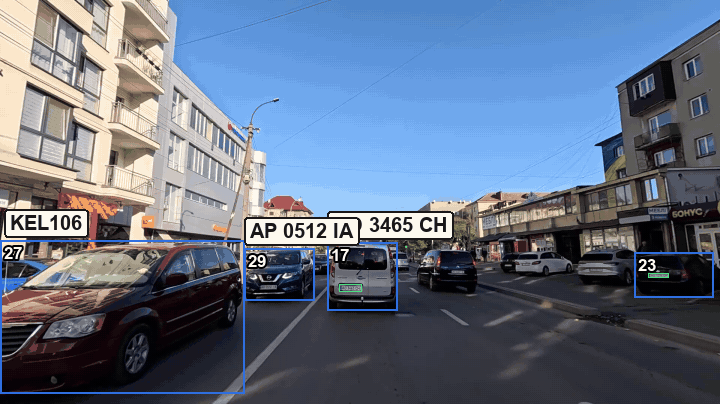
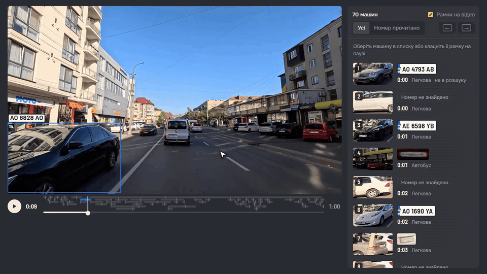
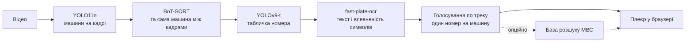

# Машини й номери на відео

Програма знаходить на відео машини, читає їхні номерні знаки і показує результат у браузерному плеєрі: рамки поверх відео, номер над кожною машиною і список усіх машин, що проїхали поруч. Номер визначається один на всю машину за весь її проїзд, а не окремо на кожному кадрі. Прочитані номери можна перевірити в базі розшуку МВС.

**[▶ Відкрити демо в браузері](https://nihlt.github.io/wanted-vehicle-video-detector/demo/)**: хвилина міської поїздки, вже оброблена програмою. Нічого встановлювати не треба.



Відео для демо — фрагмент 4:50–5:50 з [«Driving tour Ukraine, Uzhgorod 1/3»](https://www.youtube.com/watch?v=DwwC9aG9XNY) (YouTube, канал [City Bus Ukraine](https://www.youtube.com/@citybusukraine7330)).

## Швидкий старт

Потрібні Python (перевірено на 3.13) і [ffmpeg](https://ffmpeg.org/download.html) у `PATH` (Windows: `winget install ffmpeg`, macOS: `brew install ffmpeg`, Linux: `sudo apt install ffmpeg`). Моделі вже лежать у репо.

```bash
# 1. Залежності. З відеокартою NVIDIA спершу поставте torch з CUDA, без неї пропустіть цей рядок
pip install torch==2.6.0 torchvision==0.21.0 --index-url https://download.pytorch.org/whl/cu124
pip install -r requirements.txt

# 2. Обробити відео й відкрити плеєр
python run.py my_video.mp4
```

`run.py` вирізає потрібний шматок відео, знаходить машини й номери, показує прогрес у консолі, а наприкінці сам відкриває плеєр у браузері (<http://127.0.0.1:8781/runs/my_video/>). Результат лежить у `runs/my_video/`. Щоб відкрити його знову без обробки: `python run.py my_video.mp4 --view` (з тими самими `--start`/`--duration`, якщо вони були).

Скільки це триває (RTX 4050 Laptop): хвилина відео 1080p обробляється ~5,5 хв, а з `--gpu-plates` ~2 хв ([як увімкнути](#номери-на-відеокарті)). Без відеокарти NVIDIA теж працює, але в рази повільніше. Щоб швидко перевірити, що все встановилось, додайте `--limit 10`: тоді обробляються лише перші 10 секунд (~1 хв).

**Тестове відео** з демо — [«Driving tour Ukraine, Uzhgorod 1/3»](https://www.youtube.com/watch?v=DwwC9aG9XNY). Повністю його в репо немає. Завантажте його (наприклад, через [yt-dlp](https://github.com/yt-dlp/yt-dlp)), збережіть як `bus-driving.webm` і обробіть ту саму хвилину, що на демо:

```bash
python run.py bus-driving.webm --start 4:50 --duration 60
```

## Плеєр



- **▶ / пробіл** — відтворення й пауза.
- **Клік по машині в списку** — кадр, де номер видно найчіткіше, на паузі. Вибрана машина підсвічена, нижче вирізка номера.
- **Клік по рамці на відео** (на паузі) — вибрати цю машину.
- **← →** — попередня / наступна машина; **Esc** — зняти вибір.
- **Таймлайн:** над смугою прокрутки доріжки з проїздами машин; клік по доріжці вибирає машину.
- **«Номер прочитано»** — лише машини з прочитаним номером. **«Рамки на відео»** — сховати або показати рамки.
- Під час відтворення список сам переходить до машини, що з'явилась.

## Як це працює




Обробка йде у два етапи. Перший довгий, і його результат зберігається в кеш. Другий займає секунди, тож логіку рішень і плеєр можна змінювати без нового проходу по відео (`--reuse`).

**Етап 1. Прохід по відео** (`tools/process_clip.py`):

1. Береться кожен другий кадр (~30 на секунду з 60). Нейромережа YOLO11n знаходить на ньому легкові, вантажівки, автобуси й мотоцикли.
2. Трекер BoT-SORT склеює рамки сусідніх кадрів в одну машину. Так виходить трек: та сама машина від появи до зникнення. Трекер враховує рух самої камери, бо відео знято з машини, що їде.
3. На кожній близькій машині (рамка від 25 000 px², це приблизно 160×160) детектор табличок YOLOv9-t шукає номер, а OCR fast-plate-ocr читає текст і дає впевненість для кожного символу. Далекі машини теж трекаються, але не показуються: номер на них однаково не прочитати.

**Етап 2. Рішення** (`tools/track_plates.py`, `tools/smooth_boxes.py`):

4. Номер машини визначається голосуванням усіх читань за проїзд (докладніше нижче).
5. Рамка номера показується лише на кадрах, де прочитано саме цей номер. Тому вона не перескакує на фари чи на номер сусідньої машини.
6. Для картки машини обирається найкращий кадр: машина не обрізана краєм, номер видно найчіткіше.
7. Рамки згладжуються в часі, а плеєр ставить їх між порахованими кадрами пропорційно часу. Тому вони йдуть плавно, точно за машиною.

На виході `data.js` (рамки на кожному кадрі й картки машин) і вирізки машин та номерів. Плеєр — статична сторінка без збирання (`player/index.html`, `app.js`, `style.css`).

### Чому голосування, а не найкращий кадр

OCR помиляється на окремих кадрах: машина далеко, кадр розмитий, табличку частково закрито. Машину №17 з картинки вище (фургон перед автобусом) видно 50 секунд, і за цей час номер прочитано 634 рази:

| Що прочитав OCR | Скільки разів |
|---|---|
| `AO3465CH` | 585 |
| `AO3445CH` | 7 |
| `AO3466CH` | 5 |
| `AO3446CH` | 4 |
| інші варіанти | 33 |

Як з цього виходить одне рішення:

- **Вага читання дорівнює впевненості його найслабшого символу.** Чіткий кадр важить ~1.0, розмитий ~0.1. Читання слабші за 0.2 не голосують зовсім.
- **Перемагає текст з найбільшою сумарною вагою.** Схожі читання (різниця в один-два символи) теж його частково підтримують. Потім кожен символ уточнюється голосуванням серед читань тієї самої довжини.
- **Статус номера:**
  - **прочитано**, якщо рішення підтвердило хоча б одне чітке читання (усі символи ≥ 0.8) або щонайменше три узгоджені читання середньої якості;
  - **непевно** (у плеєрі з «?»), якщо чіткого читання немає, але найкраще узгоджене має впевненість ≥ 0.5;
  - **не прочитано** в решті випадків. Текст з самих лише розмитих кадрів (на кшталт `1111`) не показується.

Для №17 рішення `AO3465CH` зі статусом «прочитано» і впевненістю 96%: стільки важать читання, що точно збіглися з рішенням. Через це текст над машиною не скаче з кадру на кадр, а для правильного номера досить кількох чітких кадрів.

### Перевірка в базі розшуку

З `--wanted` прочитані номери перевіряються в базі розшуку МВС через [cardetect.in.ua](https://cardetect.in.ua/wanted-check) (`tools/wanted_check.py`). База шукає лише кирилицею, тому латиниця з OCR перекладається (`AO` → `АО`). Перевіряються тільки номери стандартного українського формату. Збіг позначається в плеєрі червоним, а в подробицях видно марку й колір з бази, щоб звірити з фото: OCR міг помилитись на символ і влучити в чужий номер.

Це недокументований API стороннього сайту, тому запити йдуть з паузою, а відповіді кешуються в `dataset/full/wanted.json`. Щоб перевірити заново, видаліть цей файл.

## Результати на тестовому відео

Поїздка містом, 23:29, 1080p, 60 кадрів/с ([джерело](#тестове-відео)).

- **Усе відео:** 709 машин поруч. Номер прочитано в 354, непевно в 58, не прочитано в 297 (далеко, збоку або розмито).
- **Перевірка на ручній розмітці:**
  - **номери:** на кадрах з датасету знайдено 18 з 18 номерів і прочитано 18 з 18; у хвилині 4:50–5:50 збіглися 8 з 8 розмічених, серед них іменний `KEL106` і чеський `2TX2967`;
  - **трекінг:** на еталоні тієї самої хвилини трекер не склеїв жодної пари різних машин, але 4 рази розбив одну машину на дві картки.
- **Швидкість** (RTX 4050 Laptop + i5-13500H):
  - хвилина відео: 5,5 хв, коли номери читаються на процесорі, або 2 хв на відеокарті;
  - усе відео: 1 год 12 хв (номери на процесорі).

## Запуск докладніше

### Параметри `run.py`

| Параметр | Що робить |
|---|---|
| `--start 4:50`, `--duration 60` | обробити лише шматок відео (час у секундах або `хв:с`) |
| `--limit 10` | лише перші 10 с шматка, щоб швидко перевірити |
| `--gpu-plates` | читати номери на відеокарті, у ~3 рази швидше ([див. нижче](#номери-на-відеокарті)) |
| `--wanted` | перевірити прочитані номери в базі розшуку |
| `--reuse` | не проганяти відео заново: лише рішення й плеєр з кешу (секунди) |
| `--view` | нічого не обробляти, лише відкрити плеєр |
| `--name`, `--port`, `--no-serve`, `--no-open` | назва папки в `runs/`, порт сервера, без сервера, без браузера |
| інші параметри | передаються в `tools/process_clip.py`, наприклад `--min-area 12000` |

Сервер працює, доки не натиснути Ctrl+C. Прогрес обробки пишеться також у `runs/<назва>/progress.log`. Раз на 5 хв зроблене зберігається в кеш (`pass.json`). Якщо процес упаде, `--reuse` збере плеєр з уже обробленої частини.

### Номери на відеокарті

`onnxruntime-gpu` ставиться в окрему папку, щоб не конфліктувати зі звичайним `onnxruntime`:

```bash
pip install --no-deps --target tools/.ort_gpu onnxruntime-gpu==1.26.0
python run.py my_video.mp4 --gpu-plates
```

Номери читаються так само, як на процесорі: на 99 читаннях результат збігся до цифри. CUDA береться з torch, тому потрібен torch з CUDA (див. [швидкий старт](#швидкий-старт)). Без `run.py` це вмикається змінною оточення `PLATES_DEVICE=gpu`.

### Вручну, без `run.py`

Так зроблено демо: хвилина 4:50–5:50 оброблена в `player/`, а звідти стиснута в `demo/`. Команди виконуються з кореня репо. На Windows, якщо вивід ламається на українських літерах, задайте `set PYTHONIOENCODING=utf-8`.

```bash
# хвилина відео -> player/ (сторінка player/index.html бере clip.mp4 і data.js зі своєї папки)
ffmpeg -ss 290 -i bus-driving.webm -t 60 -an -c:v libx264 -crf 18 -preset fast player/clip.mp4
python tools/process_clip.py player/clip.mp4 player --offset 290

# сервер з підтримкою HTTP Range (без неї браузер не вміє перемотувати відео)
python tools/serve.py . 8781        # -> http://127.0.0.1:8781/player/

# онлайн-демо: кліп 720p (~15 МБ), дані й вирізки -> demo/
python tools/make_demo.py player demo
```

Демо на GitHub Pages відкривається прямо з репо: Settings → Pages → гілка `main`, папка `/ (root)`. Сторінка буде за адресою `https://<користувач>.github.io/<репо>/demo/`.

Інші інструменти:

- `python tools/wanted_check.py player/data.js` — перевірити прочитані номери в базі розшуку; результат (`wanted.js`) плеєр підхоплює сам.
- `python tools/render_demo.py player/data.js player/clip.mp4 docs/demo.gif --pick 6` — демо-GIF, як вгорі цього файлу.
- `python tools/check_boxes.py dataset/clip/pass.json player/data.js` — наскільки плавні рамки і чи не відійшли від детектора.

## Структура

| Шлях | Що там |
|---|---|
| `run.py` | запуск однією командою: відео → обробка → плеєр у браузері |
| `tools/process_clip.py` | весь ланцюжок: відео → `data.js` + вирізки для плеєра |
| `tools/plates_nn.py`, `tools/track_plates.py` | пошук і читання номерів; одне рішення на машину |
| `tools/smooth_boxes.py` | плавні рамки для показу |
| `tools/wanted_check.py` | перевірка прочитаних номерів у базі розшуку → `wanted.js` для плеєра |
| `tools/serve.py`, `tools/make_demo.py`, `tools/render_demo.py`, `tools/check_boxes.py` | сервер для плеєра, онлайн-демо, демо-GIF, перевірка рамок |
| `tools/find_plates.py` | класичний пошук номера без нейромережі (ранній варіант); з нього ж беруться перетин рамок і оцінка на розмітці |
| `tools/research/` | дослідницькі скрипти ранніх кроків: розмітка еталона, порівняння трекерів, заміри швидкості. Розраховані на відеокарту NVIDIA |
| `player/` | плеєр (`index.html`, `app.js`, `style.css`); його ж використовують сторінки в `demo/` і `runs/` |
| `demo/` | онлайн-демо: хвилина відео 720p, дані й вирізки ([відкрити](https://nihlt.github.io/wanted-vehicle-video-detector/demo/)) |
| `runs/` | результати `run.py`, по папці на відео (у git не потрапляють) |
| `models/` | ваги моделей і їхні ліцензії ([звідки](models/README.md)) |
| `dataset/` | ручна розмітка для перевірки: номери на кадрах (`labels_draft.json`), еталон машин у хвилині (`clip/gt/`). [Опис](dataset/README.md) |
| `docs/` | [мета проєкту і формат даних](docs/GOAL.md), [журнал розробки](docs/PIPELINE.md), картинки для README |

Повна історія розробки з цифрами, відкинутими варіантами і поясненнями — у [docs/PIPELINE.md](docs/PIPELINE.md).

## Обмеження

- **Далекі машини й машини збоку** часто лишаються без номера: табличка надто мала або її не видно.
- **Одна машина іноді стає двома картками**, коли її надовго закриває інша. Зшивання таких треків заднім числом ще в планах.
- **Перевірено на Windows 11 і відео 1080p.** Поріг «близька машина» задано в пікселях, тож на відео меншої роздільності номерів буде менше; можна зменшити `--min-area` (для 720p приблизно `11000`). Дослідницькі скрипти (крім основного ланцюжка) очікують відеокарту NVIDIA.
- **OCR може помилитись на символ.** Збіг з базою розшуку — привід звірити марку й колір, а не висновок.

## Тестове відео

[«Driving tour Ukraine, Uzhgorod 1/3»](https://www.youtube.com/watch?v=DwwC9aG9XNY), канал [City Bus Ukraine](https://www.youtube.com/@citybusukraine7330) на YouTube: 23:29, 1080p, 60 кадрів/с. Права на відео належать автору. Повністю його в репо немає. У `demo/` лежить хвилина 4:50–5:50 у зниженій якості, а в `docs/` — кадри з неї: вони тільки показують, як працює програма.

## Ліцензія

Код — [AGPL-3.0](LICENSE), як і в [Ultralytics](https://github.com/ultralytics/ultralytics), на якому він побудований. Ліцензії моделей описано в [models/README.md](models/README.md): YOLO11n — AGPL-3.0, моделі номерів — MIT.
