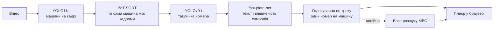

# Технічні подробиці

Як усе влаштовано всередині, усі параметри запуску й цифри перевірок. Коротко про проєкт — у [README](../README.md), повна історія розробки — у [журналі](PIPELINE.md).

## Ланцюжок обробки



Обробка йде у два етапи. Перший довгий, і його результат зберігається в кеш. Другий займає секунди, тож логіку рішень і плеєр можна змінювати без нового проходу по відео (`--reuse`).

**Етап 1. Прохід по відео** (`tools/process_clip.py`):

1. Береться кожен другий кадр (~30 на секунду з 60). Нейромережа YOLO11n знаходить на ньому легкові, вантажівки, автобуси й мотоцикли.
2. Трекер BoT-SORT склеює рамки сусідніх кадрів в одну машину. Так виходить трек: та сама машина від появи до зникнення. Трекер враховує рух самої камери, бо відео знято з машини, що їде.
3. На кожній близькій машині (рамка від 25 000 px², це приблизно 160×160) детектор табличок YOLOv9-t шукає номер, а OCR fast-plate-ocr читає текст і дає впевненість для кожного символу. Далекі машини теж трекаються, але не показуються: номер на них однаково не прочитати.

**Етап 2. Рішення** (`tools/track_plates.py`, `tools/smooth_boxes.py`):

4. Номер машини визначається голосуванням усіх читань за проїзд (див. нижче).
5. Рамка номера показується лише на кадрах, де прочитано саме цей номер. Тому вона не перескакує на фари чи на номер сусідньої машини.
6. Для картки машини обирається найкращий кадр: машина не обрізана краєм, номер видно найчіткіше.
7. Рамки згладжуються в часі, а плеєр ставить їх між порахованими кадрами пропорційно часу, тож вони йдуть плавно за машиною.

На виході `data.js` (рамки на кожному кадрі й картки машин) і вирізки машин та номерів. Плеєр — статична сторінка без збирання (`player/index.html`, `app.js`, `style.css`).

## Голосування

OCR помиляється на окремих кадрах: машина далеко, кадр розмитий, табличку частково закрито. Фургон №17 з [картинки в README](how-it-works.jpg) видно 50 секунд, і за цей час номер прочитано 634 рази:

| Що прочитав OCR | Скільки разів |
|---|---|
| `AO3465CH` | 585 |
| `AO3445CH` | 7 |
| `AO3466CH` | 5 |
| `AO3446CH` | 4 |
| інші варіанти | 33 |

Як з цього виходить одне рішення:

- Вага читання дорівнює впевненості його найслабшого символу. Чіткий кадр важить ~1.0, розмитий ~0.1. Читання слабші за 0.2 не голосують зовсім.
- Перемагає текст з найбільшою сумарною вагою. Схожі читання (різниця в один-два символи) теж його частково підтримують. Потім кожен символ уточнюється голосуванням серед читань тієї самої довжини.
- Статус номера:
  - **прочитано**, якщо рішення підтвердило хоча б одне чітке читання (усі символи ≥ 0.8) або щонайменше три узгоджені читання середньої якості;
  - **непевно** (у плеєрі з «?»), якщо чіткого читання немає, але найкраще узгоджене має впевненість ≥ 0.5;
  - **не прочитано** в решті випадків. Текст з самих лише розмитих кадрів (на кшталт `1111`) не показується.

Для №17 рішення `AO3465CH` зі статусом «прочитано» і впевненістю 96%: стільки важать читання, що точно збіглися з рішенням.

## Перевірка в базі розшуку

З `--wanted` прочитані номери перевіряються в базі розшуку МВС через [cardetect.in.ua](https://cardetect.in.ua/wanted-check) (`tools/wanted_check.py`). База шукає лише кирилицею, тому латиниця з OCR перекладається (`AO` → `АО`). Перевіряються тільки номери стандартного українського формату. Збіг позначається в плеєрі червоним, а в подробицях видно марку й колір з бази, щоб звірити з фото: OCR міг помилитись на символ і влучити в чужий номер.

Це недокументований API стороннього сайту, тому запити йдуть з паузою, а відповіді кешуються в `dataset/full/wanted.json`. Щоб перевірити заново, видаліть цей файл.

## Результати на тестовому відео

Поїздка містом, 23:29, 1080p, 60 кадрів/с.

- Усе відео: 709 машин поруч. Номер прочитано в 354, непевно в 58, не прочитано в 297 (далеко, збоку або розмито).
- Номери на ручній розмітці: на кадрах з датасету знайдено 18 з 18 і прочитано 18 з 18; у хвилині 4:50–5:50 збіглися 8 з 8 розмічених, серед них іменний `KEL106` і чеський `2TX2967`.
- Трекінг на еталоні тієї самої хвилини: жодної пари різних машин не склеєно, але 4 рази одну машину розбито на дві картки.
- Швидкість (RTX 4050 Laptop + i5-13500H): хвилина відео — 5,5 хв з номерами на процесорі або 2 хв на відеокарті; усе відео — 1 год 12 хв (номери на процесорі).

## Параметри `run.py`

| Параметр | Що робить |
|---|---|
| `--start 4:50`, `--duration 60` | обробити лише шматок відео (час у секундах або `хв:с`) |
| `--limit 10` | лише перші 10 с шматка, щоб швидко перевірити |
| `--gpu-plates` | читати номери на відеокарті, у ~3 рази швидше (див. нижче) |
| `--wanted` | перевірити прочитані номери в базі розшуку |
| `--reuse` | не проганяти відео заново: лише рішення й плеєр з кешу (секунди) |
| `--view` | нічого не обробляти, лише відкрити плеєр (з тими самими `--start`/`--duration`) |
| `--name`, `--port`, `--no-serve`, `--no-open` | назва папки в `runs/`, порт сервера, без сервера, без браузера |
| інші параметри | передаються в `tools/process_clip.py`, наприклад `--min-area 12000` |

Результат лежить у `runs/<назва>/`, прогрес пишеться також у `runs/<назва>/progress.log`. Раз на 5 хв зроблене зберігається в кеш (`pass.json`); якщо процес упаде, `--reuse` збере плеєр з уже обробленої частини.

### Номери на відеокарті

`onnxruntime-gpu` ставиться в окрему папку, щоб не конфліктувати зі звичайним `onnxruntime`. Потрібен torch з CUDA.

```bash
pip install --no-deps --target tools/.ort_gpu onnxruntime-gpu==1.26.0
python run.py my_video.mp4 --gpu-plates
```

Номери читаються так само, як на процесорі: на 99 читаннях результат збігся до цифри. Без `run.py` це вмикається змінною оточення `PLATES_DEVICE=gpu`.

### Вручну, без `run.py`

Так зроблено демо: хвилина 4:50–5:50 оброблена в `player/`, а звідти стиснута в `demo/`. На Windows, якщо вивід ламається на українських літерах, задайте `set PYTHONIOENCODING=utf-8`.

```bash
# хвилина відео -> player/
ffmpeg -ss 290 -i bus-driving.webm -t 60 -an -c:v libx264 -crf 18 -preset fast player/clip.mp4
python tools/process_clip.py player/clip.mp4 player --offset 290

# сервер з підтримкою HTTP Range (без неї браузер не вміє перемотувати відео)
python tools/serve.py . 8781        # -> http://127.0.0.1:8781/player/

# онлайн-демо: кліп 720p (~15 МБ), дані й вирізки -> demo/
python tools/make_demo.py player demo
```

Демо на GitHub Pages відкривається прямо з репо: Settings → Pages → гілка `main`, папка `/ (root)`.

Інші інструменти:

- `python tools/wanted_check.py player/data.js` — перевірити номери в базі розшуку; результат (`wanted.js`) плеєр підхоплює сам.
- `python tools/render_demo.py player/data.js player/clip.mp4 docs/demo.webp --pick 6` — анімація для README.
- `python tools/check_boxes.py dataset/clip/pass.json player/data.js` — наскільки плавні рамки і чи не відійшли від детектора.

## Структура

| Шлях | Що там |
|---|---|
| `run.py` | запуск однією командою: відео → обробка → плеєр у браузері |
| `tools/process_clip.py` | весь ланцюжок: відео → `data.js` + вирізки для плеєра |
| `tools/plates_nn.py`, `tools/track_plates.py` | пошук і читання номерів; одне рішення на машину |
| `tools/smooth_boxes.py` | плавні рамки для показу |
| `tools/wanted_check.py` | перевірка номерів у базі розшуку → `wanted.js` для плеєра |
| `tools/serve.py`, `make_demo.py`, `render_demo.py`, `check_boxes.py` | сервер, онлайн-демо, анімація для README, перевірка рамок |
| `tools/find_plates.py` | класичний пошук номера без нейромережі (ранній варіант); з нього ж беруться перетин рамок і оцінка на розмітці |
| `tools/research/` | дослідницькі скрипти: розмітка еталона, порівняння трекерів, заміри швидкості (потрібна відеокарта NVIDIA) |
| `player/` | плеєр (`index.html`, `app.js`, `style.css`); його використовують `demo/` і `runs/` |
| `demo/` | онлайн-демо: хвилина відео 720p, дані й вирізки |
| `runs/` | результати `run.py` (у git не потрапляють) |
| `models/` | ваги моделей і їхні ліцензії ([звідки](../models/README.md)) |
| `dataset/` | ручна розмітка для перевірки ([опис](../dataset/README.md)) |
| `docs/` | цей файл, [мета й формат даних](GOAL.md), [журнал розробки](PIPELINE.md), картинки для README |

## Обмеження

- Поріг «близька машина» задано в пікселях і підібрано для 1080p. На відео меншої роздільності номерів буде менше; можна зменшити `--min-area` (для 720p приблизно `11000`).
- Перевірено на Windows 11. Дослідницькі скрипти з `tools/research/` очікують відеокарту NVIDIA.
